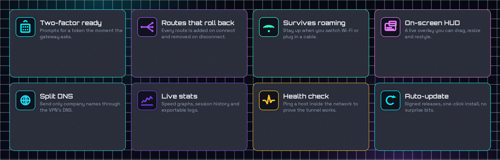
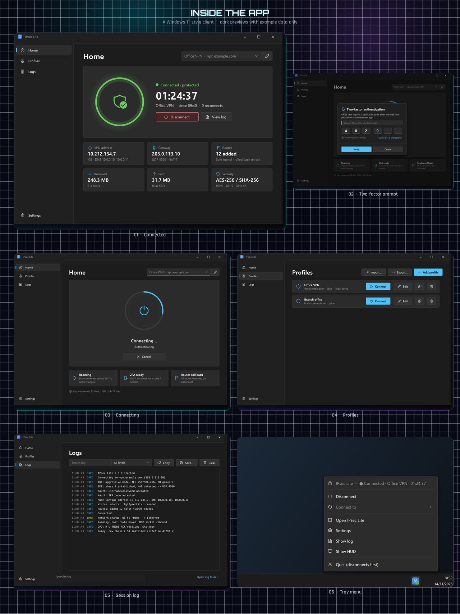
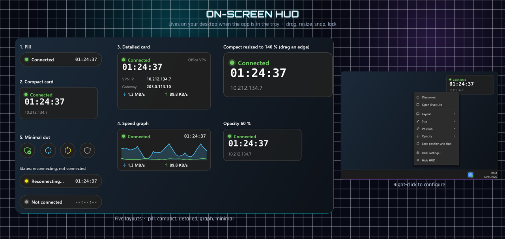
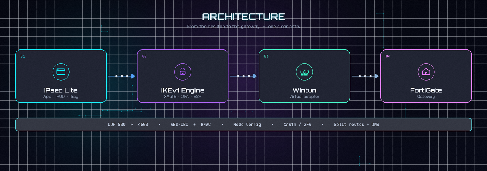
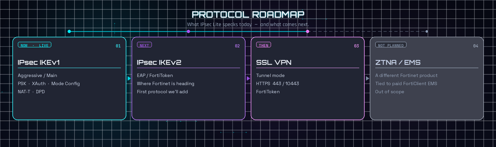
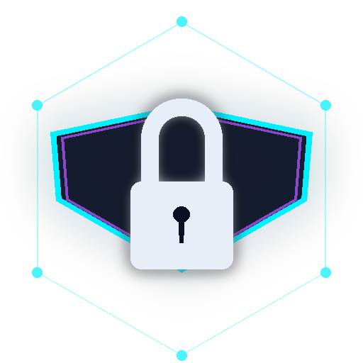

<p align="center">
  
</p>

<p align="center">
  
  
  
  
</p>

<p align="center">
  <a href="https://github.com/R0LL0/ipsec-lite-releases/releases/latest"><strong>Download the latest installer</strong></a>
  &nbsp;·&nbsp;
  <a href="#install">Install notes</a>
  &nbsp;·&nbsp;
  <a href="#faq">FAQ</a>
</p>

**IPsec Lite** is a Windows VPN client built for one job: connect to a FortiGate the same way the free FortiClient IPsec profile does — IKEv1 aggressive mode, a pre-shared key, XAuth, and Mode Config — then get out of your way.

When the gateway asks for a second factor, the app asks you for the code. When you connect, it applies the address, DNS and routes the gateway pushes. When you disconnect, it rolls every one of those changes back. Switch Wi-Fi, or plug in a cable, and the tunnel stays up.

This repository holds **signed installers and the version manifest only**. It is the public update channel the app checks.

---

<p align="center">
  
</p>

### What you get

- **2FA prompts** — If the gateway asks for a token or authenticator code after your password, a dialog appears so you can type it. (FortiToken *push* is FortiClient-only; enter the code from the app instead.)
- **Routes that roll back** — Split or full-tunnel routes are added on connect and removed on disconnect, exit, or a crash recovery pass.
- **Roaming** — Stay connected when you move from one Wi-Fi network to another, or from Wi-Fi to cable. The app rebinds and keeps the session alive.
- **Automatic address cleanup** — The VPN address is released on disconnect, so you can start FortiClient afterwards without a conflict.
- **On-screen HUD** — An optional always-on-top overlay while the app sits in the tray. Drag it, resize it, snap it, lock it, and pick a layout.
- **Split DNS** — Send only the domains you choose through the VPN’s DNS. Everything else keeps using your usual resolver. The DNS cache is flushed on connect and disconnect so names resolve immediately.
- **Live stats and history** — Speed and data graphs, a timeline of connection events, past sessions, and a log export that strips passwords and codes.
- **Health check** — Optionally ping or reach a host *inside* the network. The app can show “Tunnel OK” with the response time, or warn you when the tunnel is up but the host is silent — and reconnect if you want it to.
- **Auto-update** — The app checks this repository for a newer signed build and can install it in one click. Damaged or unsigned packages are rejected.
- **Pro licensing, in beta** — License checks and a beta expiry are already in the app, so a later paid Pro edition does not leave old free copies running forever. During the beta, those extras are unlocked.

---

## A closer look

<p align="center">
  
</p>

<p align="center">
  
</p>

---

## How it fits together

<p align="center">
  
</p>

The app talks IKE and ESP itself, using a Wintun virtual adapter (the same family of driver WireGuard uses on Windows). Crypto primitives come from the `cryptography` library and the Python standard library. The tunnel is always UDP-encapsulated (NAT-T) on port 4500.

---

## Protocol roadmap

<p align="center">
  
</p>

**Now — IPsec IKEv1.** Aggressive and main mode, a pre-shared key, XAuth, Mode Config, NAT-T, and DPD. This is what IPsec Lite supports today.

**Next — IPsec IKEv2.** EAP login and FortiToken. This is the direction Fortinet is taking newer FortiOS installs, and the first protocol we will add.

**Then — FortiGate SSL VPN.** Tunnel mode over HTTPS (ports 443 or 10443), with FortiToken. Still very common, even as Fortinet starts retiring it in recent FortiOS versions.

**Not planned — ZTNA / FortiClient EMS.** That is a different, paid Fortinet product, not a VPN protocol this client will implement.

---

## Download

Get the current Windows installer from the latest GitHub Release:

**[github.com/R0LL0/ipsec-lite-releases/releases/latest](https://github.com/R0LL0/ipsec-lite-releases/releases/latest)**

Look for `IPsecLite-Setup-2.0.1.exe` (or a newer version once one is published). The same release notes include the SHA-256 checksum. The signed manifest `latest.json` in this repository is what the app reads when it checks for updates.

---

## Install

1. Close IPsec Lite and FortiClient if either is running.
2. Run the installer. It requires **administrator** rights so it can install the virtual adapter and manage routes.
3. Windows SmartScreen may warn you the first time. The installer is newly published and may not yet have a widely recognized signature. Choose *More info* → *Run anyway* only if you downloaded it from this repository’s Releases page and the checksum matches (see below).
4. Launch **IPsec Lite** from the Start menu. Create a profile (gateway, pre-shared key, XAuth login, local ID) and connect.
5. Upgrades keep your profiles and settings. The uninstaller appears in **Settings → Apps** (Add or Remove Programs), removes the app’s registry entries, and can optionally delete your profiles.

---

## System requirements

| | |
|---|---|
| OS | Windows 10 (version 1809 / build 17763 or later) or Windows 11 |
| Architecture | 64-bit (x64) |
| Privileges | Administrator, for the adapter, routes, and optional startup task |
| Gateway | A FortiGate IPsec dial-up that uses **IKEv1 aggressive mode**, a **pre-shared key**, **XAuth**, and **Mode Config** |

---

## Verify your download

On the PC you installed from, open Command Prompt and run:

```bat
certutil -hashfile IPsecLite-Setup-2.0.1.exe SHA256
```

Compare the fingerprint with the checksum published on the [release page](https://github.com/R0LL0/ipsec-lite-releases/releases/latest). They must match exactly.

The in-app updater also verifies a signed `latest.json` manifest and the installer’s checksum before it offers to install anything. It will refuse a file that does not match.

---

## FAQ

**Is this FortiClient?**  
No. IPsec Lite is an independent client that speaks the same IPsec dialect your FortiGate already uses for the free FortiClient IPsec profile. It is not affiliated with Fortinet.

**Will it work with my FortiGate?**  
If your working FortiClient profile is IKEv1 aggressive mode, pre-shared key, XAuth (with or without a typed 2FA code), and Mode Config, this is the setup IPsec Lite is built for. Other FortiGate VPN types (SSL-VPN, IKEv2-only, certificate-only) are not supported in this beta.

**Can I run it at the same time as FortiClient?**  
Not on the same connection. Disconnect one before you start the other. IPsec Lite clears its address and routes when it disconnects so FortiClient can bind afterwards.

**Does it support FortiToken push?**  
No. Approve-on-phone push is a FortiClient extension. Open the token app and type the code when IPsec Lite asks.

**Where do updates come from?**  
Only from this public releases repository. The app does not pull installers from anywhere else, and it will not install a build whose signature or checksum fails.

**Is the beta free?**  
Yes. The beta is free to use until the date baked into that build (and any newer minimum version published in `latest.json`). A paid Pro edition is planned; license checks are already in the client so that transition is clean.

---

## Beta notice

Version **2.0.1** is a **beta**. It has been built for a real FortiGate-style profile, but you should treat it as pre-release software: keep a copy of FortiClient around, and do not rely on it as your only path into a production network until you have tested it on your own gateway.

Beta builds expire. After the expiry date a build will refuse to connect and will offer an update instead. A signed `min_supported` field in `latest.json` can also retire older builds once a newer one is out.

The IPsec engine has not had a third-party security audit. Aggressive mode with a pre-shared key is a weaker protocol choice than main mode or certificates — that is a property of the FortiGate configuration this client is matching, not something the app can invent its way out of.

---

## Disclaimer

IPsec Lite is an independent project. It is **not affiliated with, endorsed by, or sponsored by Fortinet, Inc.** Fortinet, FortiGate, FortiClient, and FortiToken are trademarks of Fortinet, Inc. All other trademarks are the property of their respective owners.

This software is provided as-is, without warranty of any kind. You are responsible for testing it against your own gateway and for the security of your pre-shared key, login, and token codes.

<p align="center">
  
</p>
